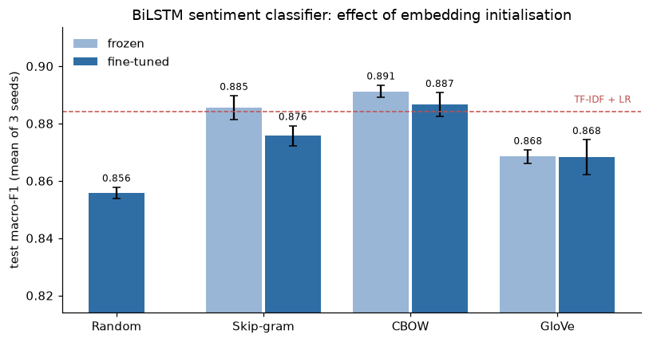
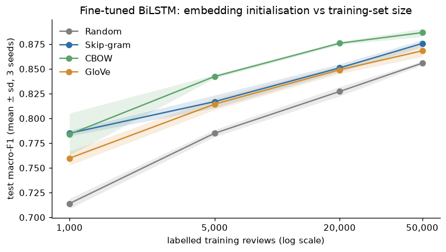
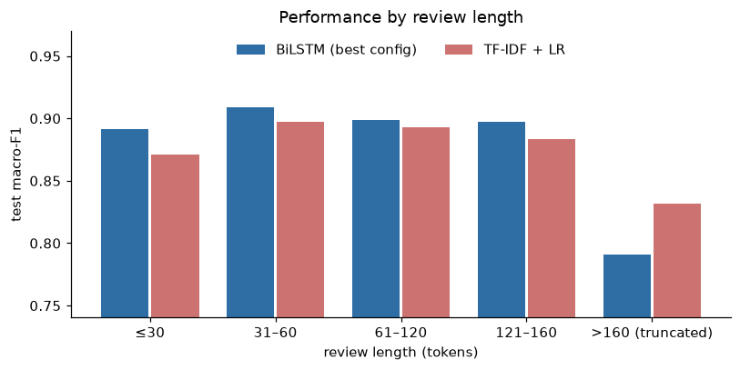

# Do Domain-Trained Word Embeddings Beat GloVe?

GloVe is trained on 6 billion tokens of Wikipedia and news. Word2Vec trained on the reviews themselves sees only 27 million tokens, but they come from the right domain. This project asks which one gives a neural sentiment classifier the better start. It holds a BiLSTM fixed and swaps only its embedding layer, using **~360k de-duplicated Amazon food reviews**.

**Tools:** Python · PyTorch · gensim · scikit-learn · pandas · Matplotlib · Jupyter

📓 **[Open the notebook](notebooks/domain_embeddings_sentiment.ipynb)**

---

## Results (test set, mean ± sd over 3 seeds)

| Embedding initialisation | Macro-F1 | Negative-class F1 |
|---|---|---|
| **CBOW, frozen** | **0.891 ± 0.002** | **0.817 ± 0.003** |
| CBOW, fine-tuned | 0.887 ± 0.004 | 0.809 ± 0.006 |
| Skip-gram, frozen | 0.886 ± 0.004 | 0.807 ± 0.007 |
| *TF-IDF + logistic regression (baseline)* | *0.884* | *0.805* |
| Skip-gram, fine-tuned | 0.876 ± 0.004 | 0.790 ± 0.007 |
| GloVe 6B, frozen | 0.868 ± 0.002 | 0.779 ± 0.004 |
| GloVe 6B, fine-tuned | 0.868 ± 0.006 | 0.778 ± 0.011 |
| Random (trained from scratch) | 0.856 ± 0.002 | 0.756 ± 0.005 |



## Key findings

1. **Domain beats scale.** Embeddings trained on the reviews outperform GloVe by +0.02 macro-F1 and +0.04 negative-class F1, even though GloVe is trained on about 200× more text. GloVe still helps, but only by less than half as much.
2. **Freezing good embeddings works best.** For every pretrained embedding, the frozen version matched or beat the fine-tuned one, while training 2.4M fewer weights.
3. **Unlabelled text is worth more than extra labels.** CBOW with 5,000 labelled reviews beats random initialisation with 20,000. CBOW with 20,000 beats random with 50,000. With only 1,000 labels, the domain embeddings add +0.07 macro-F1.
4. **Duplicates inflate the scores.** 31% of the reviews are exact duplicates. With a naive random split, 19.5% of test reviews also appear in the training set, which inflates macro-F1 by 0.014. That is more than the gap between most of the embedding choices, so all results here use de-duplicated data.
5. **A good baseline is hard to beat.** TF-IDF + logistic regression comes within 0.007 of the best BiLSTM. The BiLSTM wins on reviews of up to 160 tokens but loses on longer, truncated reviews.
6. **Many confident errors are label noise.** Examples include clearly positive text with a 1–2 star rating, and the reverse. Star ratings are only an approximate sentiment label.

| Embeddings vs labelled-data size | Performance by review length |
|---|---|
|  |  |

**What the embeddings learned.** The domain embeddings place same-polarity sentiment words much closer together than GloVe does: the mean cosine is 0.67–0.75 against 0.48–0.54. They also learn food-specific neighbours, including common misspellings: *stale → rancid, moldy* and *delicious → delicous, yummy*. GloVe reflects general usage instead, for example *bland → dull, charming* and *stale → tiresome*.

## Method

- **Data:** 1–2 star reviews are labelled negative and 4–5 star reviews positive; 3-star reviews are dropped. Exact duplicates are removed *before* splitting. There is a fixed 20k test set and a 10k validation set, and the labelled training sample has 50k reviews. All splits are stratified, with 84% positive reviews.
- **Embeddings:** Skip-gram and CBOW (100-d, gensim) are trained on 334k unlabelled reviews from the training pool, with no validation or test text. They are compared with GloVe 6B-100d, so all three embeddings have the same size.
- **Classifier:** embedding layer, then a 1-layer BiLSTM (128 per direction), then masked max-pooling, then a linear output. Inputs are the first 160 tokens of each review. Training uses Adam with gradient clipping and early stopping on validation macro-F1.
- **Evaluation:** the decision threshold is tuned on validation data and applied unchanged to the test set. Macro-F1 is the headline metric, and negative-class F1 is reported separately. Accuracy is not used because of the 84/16 class imbalance.
- **Experiments:**
  - 7 embedding configurations × 3 seeds.
  - A curve over 1k–50k labelled reviews.
  - A leakage check with and without duplicates.
  - Error analysis by review length and negation.

## Limitations

- One fixed split with 3 seeds. Word2Vec and the Apple-GPU backend are not fully deterministic, and means moved by up to 0.005 between two full runs. The ranking of configurations stayed the same.
- Reviews are truncated at 160 tokens, which visibly hurts the longest ones.
- A pretrained transformer encoder would very likely beat every configuration here. This study isolates the effect of the word-embedding layer only.

## Repository structure

```
domain-embeddings-sentiment/
├── notebooks/domain_embeddings_sentiment.ipynb   # full experiment with outputs
├── figures/                                      # charts exported from the notebook
├── requirements.txt
└── README.md
```

## Reproducing

The data is not included. Place these two files in a `data/` folder:

| File | Source |
|---|---|
| `data/Reviews.csv` | [Amazon Fine Food Reviews](https://www.kaggle.com/datasets/snap/amazon-fine-food-reviews) (Stanford SNAP, via Kaggle) |
| `data/glove.6B.100d.txt` | [GloVe 6B](https://nlp.stanford.edu/projects/glove/), from `glove.6B.zip` |

```bash
pip install -r requirements.txt
jupyter notebook notebooks/domain_embeddings_sentiment.ipynb
```

The full notebook takes about 45 minutes on an Apple-silicon GPU (MPS). CUDA and CPU also work.

## References

- McAuley, J. & Leskovec, J. (2013). *From Amateurs to Connoisseurs: Modeling the Evolution of User Expertise through Online Reviews.* WWW 2013.
- Mikolov, T. et al. (2013). *Efficient Estimation of Word Representations in Vector Space.* arXiv:1301.3781.
- Pennington, J., Socher, R. & Manning, C. D. (2014). *GloVe: Global Vectors for Word Representation.* EMNLP 2014.
